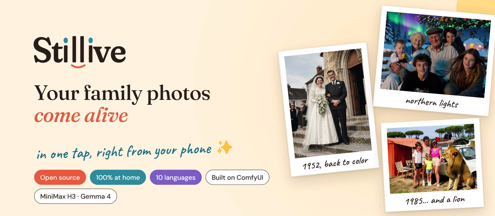
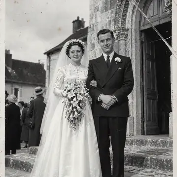
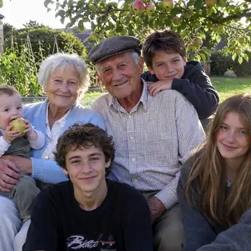
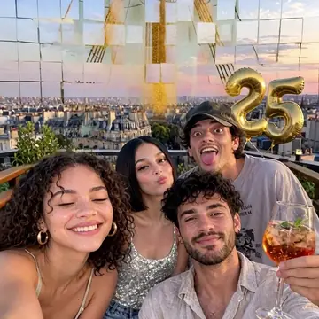
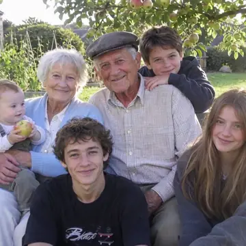
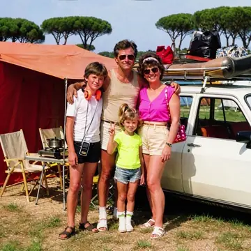
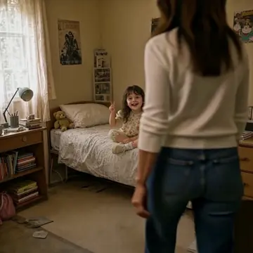
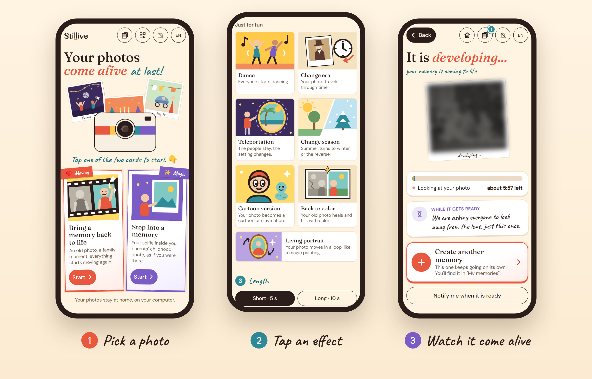

  

  <b>Stillive turns a single photo into a short living clip, with music and ambient sound, ready to share.</b> 
  A family picture, a vintage print, a phone snapshot. Made for everyone, from grandparents to kids: 
  no AI knowledge, no settings, nothing to learn.

  <a href="https://youtu.be/y-H-o6KGTco"><b>▶ Watch the demo on YouTube</b></a> (with subtitles)
  &nbsp;·&nbsp; <a href="#install">Install</a>
  &nbsp;·&nbsp; <a href="#privacy-and-child-safety">Privacy</a>
  &nbsp;·&nbsp; <a href="#how-it-works">How it works</a>

https://github.com/user-attachments/assets/d75e809e-a7ef-4136-a0e9-a6f3f3a2dd01

## ✨ One photo, a clip that comes alive

<table>
  <tr>
    <td align="center" width="33%"> <b>Back to color</b> a wedding photo from 1952</td>
    <td align="center" width="33%"> <b>Teleportation</b> the family garden, under the northern lights</td>
    <td align="center" width="33%"> <b>Change era</b> a group of friends, on a pirate ship</td>
  </tr>
  <tr>
    <td align="center"> <b>Surprise me!</b> the AI imagines the moment</td>
    <td align="center"> <b>Tell your story</b> "a lion visits our 1985 camping trip"</td>
    <td align="center"> <b>Step into a memory</b> hug your younger self</td>
  </tr>
</table>

## 📱 Three steps, from the phone

  

## 👨‍👩‍👧 Made for the whole family

- **Set up once** on the home computer. After that, everyone just uses their phone.
- **No app to install**: scan the QR code once, and Stillive opens in the phone's browser.
- **Three steps**: pick a photo (or scan a paper print with the phone camera), tap an effect, watch your clip a few minutes later.
- **Big, friendly buttons**, playful waiting screen, in 10 languages (English, Chinese, Spanish, Arabic, Portuguese, Indonesian, French, Japanese, Russian, German).
- **Private by design**: everything runs on your own computer, nothing leaves your home.

## 🎬 What you can do

**Bring a memory back to life**: the AI looks at the photo, imagines a natural moment and animates it.
- *Bring my photo to life*: "Natural" or "Surprise me!".
- *Just for fun*: Dance, Change era (pirates, Versailles, the 80s… or any year), Teleportation (the Moon, Times Square, northern lights… or any place), Change season, Cartoon or claymation, Back to color, Living portrait (seamless loop), Tell your story (write what happens).

**Step into a memory**: take a selfie and appear inside any photo, for example your parents' childhood picture.
- Automatic, Selfie with them, Balloon arrival, Dance with them, Superhero entrance, Magic portal, Reunion, Out of the scenery, Tarzan vine, Electric scooter, Glitch appearance, Hug your younger self.

Clips are short (5 seconds) or long (10 seconds), with an optional little note at the end. Each clip comes in a vertical and a horizontal version. "My memories" keeps all your clips; download any of them in one tap.

## 🖥️ What you need

- A Windows or Linux computer with an NVIDIA graphics card with at least 12 GB of video memory, and 32 GB of RAM.
- Free disk space for the models, downloaded automatically: about 50 GB, plus 23 GB for "Step into a memory" (optional), plus about 5 GB for ComfyUI if you don't have it yet.
- A phone on the same Wi-Fi network as the computer.

## 📦 Install

1. Download this repository (green "Code" button, then "Download ZIP") and unzip it.
2. Double-click `installer/INSTALLER.bat` (on Linux: `python3 installer/install_stillive.py`). It needs Python 3.9 or later and tells you how to get it if it is missing.
3. Click "Install Stillive".
   - **You don't have ComfyUI**: the installer sets it up for you, adds Stillive, then opens the preparation page.
   - **You already have ComfyUI**: choose your ComfyUI folder in advanced mode; only Stillive is added. Restart ComfyUI, then click "Set up Stillive" in the small message ComfyUI shows.
4. The preparation page downloads the models (this can take a while), then shows a QR code.
5. Scan the QR code with your phone. The first time, Windows may ask to allow Python on the network: click "Allow" (private network).

## ☕ Everyday use

- Start: the "Stillive" shortcut on the desktop (or `start_stillive.bat` in the install folder). Stop: `stop_stillive.bat`.
- On the phone: open the saved page, pick a photo (or scan a paper photo), choose an effect, wait a few minutes, watch and download.
- Update: download the new version and run the installer again. Your settings, models and clips are kept.
- Uninstall: on the computer, open the preparation page, section "Uninstall Stillive", and choose what to remove. It only removes what Stillive installed itself, never your own models.

## 🔒 Privacy and child safety

Stillive is made for family photos, often with children in them. Here is exactly what it does with them.

**Your photos stay at home**
- Everything runs on your own computer. Stillive sends no photo, video or text online: no account, no tracking, no statistics, no fonts or scripts loaded from the internet. The only connections are the downloads of the software and the AI models during installation and updates (GitHub, Hugging Face).
- The phone page only opens with the secret code inside the QR code, so nobody else on your Wi-Fi can see your photos. Settings, installation and uninstallation are only available on the computer itself.
- The app reminds you to use photos of your family with their consent, especially for children.

**You stay in control of your data**
- Delete one clip, or all of them with "Delete all". Scanned paper photos and idea suggestions are deleted automatically after one hour. Finished clips stay until you delete them.
- The phone keeps your last photos in its browser so you can reuse them; each one can be removed.
- Uninstalling (from the computer) removes what Stillive installed, after showing you the list.
- Since nothing leaves your home, you are the only one holding your family's photos (in GDPR terms, the processing stays private and under your control).

**Children in the photos**
- When a young child is in the photo, the effects are written to keep them a child: "Back to childhood" turns adults into the children they were, and children stay children; "Hug your younger self" first checks that a child is really there.
- Every effect is a gentle, family-oriented preset (dance, travel in time, bring back colors, cartoon version...).

**About the AI models, honestly**
- Gemma 4 (Google): its training data was filtered for child sexual abuse material and sensitive personal data, according to Google's model card.
- MiniMax H3: MiniMax describes automatic moderation of inputs on its own online platform; that moderation does not run when the model works locally on your computer.
- Qwen Image (photo restoration): no safety filter is announced by its publisher.
- Stillive does not add an automatic content filter. The app is designed for family memories, and the adults using it remain responsible for the photos and texts they choose.

## ⚙️ How it works

1. **Gemma 4 12B** (run locally by llama.cpp inside a Stillive ComfyUI node) looks at the photo and writes a precise, timed prompt for the chosen effect.
2. **MiniMax H3** turns the photo into a video with its own music and ambient sound (image to video, or reference to video with your selfie for "Step into a memory"), using the official 4-step turbo LoRA.
3. Stillive trims the clip, adds your note and sends it to your phone.

The H3 graphs Stillive sends to ComfyUI are in [`stillive/workflows/`](stillive/workflows/) (ComfyUI API format).

## 🧩 Models and licenses

Stillive ships no model weights; they are downloaded from their official pages. See [MODELS-AND-LICENSES.md](MODELS-AND-LICENSES.md).

## 📜 License

Stillive's code is released under the GNU Affero General Public License v3.0 ([LICENSE](LICENSE)).
